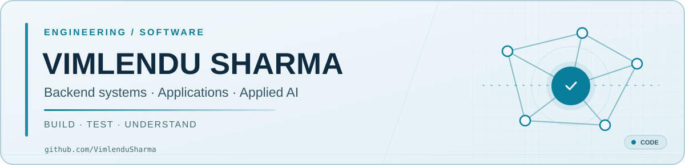

  <picture>
    <source
      media="(prefers-color-scheme: dark)"
      srcset="./banner-dark.svg"
    />
    <source
      media="(prefers-color-scheme: light)"
      srcset="./banner-light.svg"
    />
    
  </picture>

<h1 align="center">Hi, I'm Vimlendu.</h1>

<strong>Software engineering · Backend & systems · Applied AI</strong>

  <a href="https://www.linkedin.com/in/vimlendu-sharma-629176208/">LinkedIn</a> &nbsp;·&nbsp;
  <a href="https://github.com/VimlenduSharma?tab=repositories">Repositories</a> &nbsp;·&nbsp;
  <a href="https://www.kaggle.com/vimlendusharma">Kaggle</a> &nbsp;·&nbsp;
  <a href="mailto:vimendusharma@gmail.com">Email</a>

I'm a Computer Science graduate interested in how applications behave beyond the happy path. I like building features, tracking down failures, and making the results easier for someone else to run and understand.

My projects range from full-stack applications to infrastructure diagnostics and hardware verification. I'm also interested in reliable backend services and practical AI tooling.

### Selected work

- **[Analytics Admin Dashboard](https://github.com/VimlenduSharma/ANALYTICS-ADMIN-DASHBOARD)** — An Angular and NestJS analytics workspace covering operational metrics, tenant-aware APIs, data imports, and governance workflows. The repository documents its architecture, local setup, and verification approach.
- **[SocialHub](https://github.com/VimlenduSharma/SocialHub---Social-media-platform-)** — A React and Node.js social application with user profiles, posts, reactions, comments, and notifications.
- **[Windows Fleet Health Toolkit](https://github.com/VimlenduSharma/WINDOWS-FLEET-HEALTH-DIAGNOSTICS-TOOLKIT)** — PowerShell-based host collection with Python diagnostics for services, DNS, TCP, and HTTP checks.
- **[FIFO & Arbiter Verification Lab](https://github.com/VimlenduSharma/FIFO-ARBITER-FORMAL-VERIFICATION-MINI-LAB)** — SystemVerilog components and verification flows combining simulation, assertions, regression testing, and formal checks.

### Technologies I use

**Languages:** Java · Python · C++ · TypeScript · JavaScript · SQL  
**Applications:** Spring Boot · React · Angular · Node.js · REST APIs  
**Tools & infrastructure:** Git · Linux · Docker · PostgreSQL · PowerShell

### How I work

I prefer clear interfaces, reproducible tests, and documentation that explains the decisions as well as the setup. When a project has limitations or unfinished work, I'd rather state them than hide them behind a badge.

Always learning; currently interested in backend reliability, developer tooling, and applied AI.
